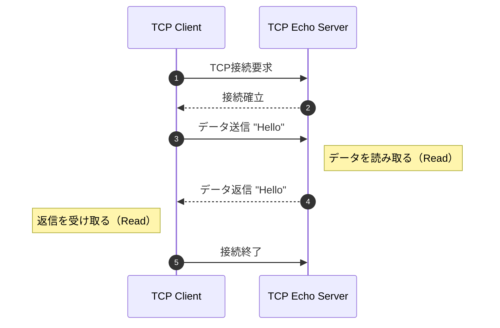

# TCP Echo Server

クライアントから受け取ったデータをそのまま送り返すサーバー



## 処理の流れ

1. クライアントからのTCP接続を受け付ける
2. 接続からデータを読み取る
3. 同じデータをその接続に書き戻す

## 動作確認

```bash
$ go run ./experiments/tcp-echo/

2026/xx/xx 00:00:20 127.0.0.1:9000で接続を待っています
2026/xx/xx 00:02:17 接続:  127.0.0.1:54621
2026/xx/xx 00:02:32 相手から受信が終了しました
2026/xx/xx 00:02:32 接続処理終了:  127.0.0.1:54621
```

別ターミナルでncコマンドで適当なデータをTCPで送信すると、Echo Serverは受け取ったデータをそのまま送り返してくる

```bash
$ nc 127.0.0.1 9000

hello
hello

wow
wow
```
